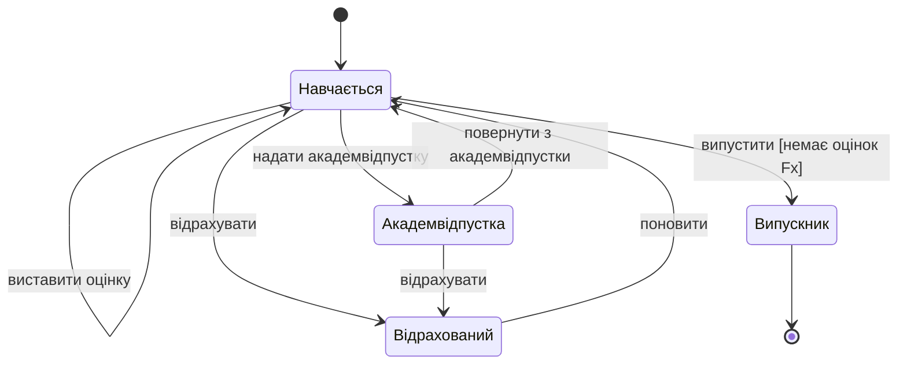

# Переходи станів (Р-18)

Методи `student.change_status(event)` і `student.add_grade(grade)`. Виставлення оцінки — подія, яка не змінює стан.

## Діаграма

## Таблиця станів

| Стан \ подія | надати академвідпустку | повернути з академвідпустки | відрахувати | поновити | випустити | виставити оцінку |
|---|---|---|---|---|---|---|
| Навчається | Академвідпустка | — | Відрахований | — | Випускник [немає Fx] | Навчається |
| Академвідпустка | — | Навчається | Відрахований | — | — | — |
| Відрахований | — | — | — | Навчається | — | — |
| Випускник | — | — | — | — | — | — |

Усього 24 переходи: 7 допустимих і 17 недопустимих.

## Тестові випадки

Передумову недопустимих переходів задано в конструкторі (`status=...`) з однією оцінкою `Grade("Python", 85)`, щоб перевірити, що оцінки не змінюються. Послідовності TB-ST-01–03 починаються з нового студента.

| ID | Покриває | Передумова | Кроки | Очікуваний результат | Фактичний результат | Статус |
|----|----------|------------|-------|----------------------|---------------------|--------|
| TB-ST-01 | 6 допустимих переходів | Новий студент, «Навчається» | оцінка 80 → TAKE_LEAVE → RETURN → EXPEL → REINSTATE → GRADUATE | Навчається → Академвідпустка → Навчається → Відрахований → Навчається → Випускник | ACTIVE → ON_LEAVE → ACTIVE → EXPELLED → ACTIVE → GRADUATED, оцінка 80 збережена | Пройдено |
| TB-ST-02 | Академвідпустка + відрахувати | Новий студент, «Навчається» | TAKE_LEAVE → EXPEL | Академвідпустка → Відрахований | ON_LEAVE → EXPELLED | Пройдено |
| TB-ST-03 | випустити, умова хибна | Новий студент, «Навчається» | оцінка 40 (Fx) → GRADUATE | `InvalidTransitionError`; статус «Навчається», оцінки [40] | `InvalidTransitionError: не можна випустити студента з оцінками Fx`; ACTIVE, [40] | Пройдено |
| TB-ST-04 | Навчається + повернути | «Навчається» | RETURN | `InvalidTransitionError`; статус і оцінки без змін | `InvalidTransitionError: подія «повернути з академвідпустки» неможлива для статусу «навчається»`; ACTIVE, [85] | Пройдено |
| TB-ST-05 | Навчається + поновити | «Навчається» | REINSTATE | те саме | `InvalidTransitionError: подія «поновити» неможлива для статусу «навчається»`; ACTIVE, [85] | Пройдено |
| TB-ST-06 | Академвідпустка + надати академвідпустку | «Академвідпустка» | TAKE_LEAVE | те саме | `InvalidTransitionError: подія «надати академвідпустку» неможлива для статусу «академвідпустка»`; ON_LEAVE, [85] | Пройдено |
| TB-ST-07 | Академвідпустка + поновити | «Академвідпустка» | REINSTATE | те саме | `InvalidTransitionError: подія «поновити» неможлива ...`; ON_LEAVE, [85] | Пройдено |
| TB-ST-08 | Академвідпустка + випустити | «Академвідпустка» | GRADUATE | те саме | `InvalidTransitionError: подія «випустити» неможлива ...`; ON_LEAVE, [85] | Пройдено |
| TB-ST-09 | Академвідпустка + виставити оцінку | «Академвідпустка» | `add_grade(Grade("Python", 80))` | `InvalidTransitionError`; оцінки [85] | без помилки; ON_LEAVE, оцінки [85, 80] | **Не пройдено** |
| TB-ST-10 | Відрахований + надати академвідпустку | «Відрахований» | TAKE_LEAVE | `InvalidTransitionError`; без змін | `InvalidTransitionError: подія «надати академвідпустку» неможлива для статусу «відрахований»`; EXPELLED, [85] | Пройдено |
| TB-ST-11 | Відрахований + повернути | «Відрахований» | RETURN | те саме | `InvalidTransitionError: ...`; EXPELLED, [85] | Пройдено |
| TB-ST-12 | Відрахований + відрахувати | «Відрахований» | EXPEL | те саме | `InvalidTransitionError: подія «відрахувати» неможлива ...`; EXPELLED, [85] | Пройдено |
| TB-ST-13 | Відрахований + випустити | «Відрахований» | GRADUATE | те саме | `InvalidTransitionError: подія «випустити» неможлива ...`; EXPELLED, [85] | Пройдено |
| TB-ST-14 | Відрахований + виставити оцінку | «Відрахований» | `add_grade(Grade("Python", 80))` | те саме | `InvalidTransitionError: не можна виставити оцінку відрахованому студенту`; EXPELLED, [85] | Пройдено |
| TB-ST-15 | Випускник + надати академвідпустку | «Випускник» | TAKE_LEAVE | те саме | `InvalidTransitionError: ...`; GRADUATED, [85] | Пройдено |
| TB-ST-16 | Випускник + повернути | «Випускник» | RETURN | те саме | `InvalidTransitionError: ...`; GRADUATED, [85] | Пройдено |
| TB-ST-17 | Випускник + відрахувати | «Випускник» | EXPEL | `InvalidTransitionError`; статус «Випускник» | `Status.EXPELLED`; статус EXPELLED | **Не пройдено** |
| TB-ST-18 | Випускник + поновити | «Випускник» | REINSTATE | `InvalidTransitionError`; без змін | `InvalidTransitionError: ...`; GRADUATED, [85] | Пройдено |
| TB-ST-19 | Випускник + випустити | «Випускник» | GRADUATE | те саме | `InvalidTransitionError: ...`; GRADUATED, [85] | Пройдено |
| TB-ST-20 | Випускник + виставити оцінку | «Випускник» | `add_grade(Grade("Python", 80))` | `InvalidTransitionError`; оцінки [85] | без помилки; GRADUATED, оцінки [85, 80] | **Не пройдено** |

**Покриття:** стани — 4 з 4 (100 %); допустимі переходи — 7 з 7 (100 %, двома послідовностями TB-ST-01 і TB-ST-02); усі переходи — 24 з 24 (100 %), а також окремий тест TB-ST-03 на перехід з хибною умовою.
