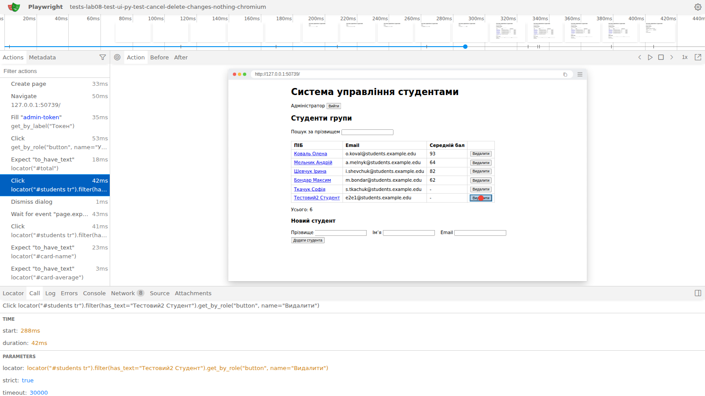
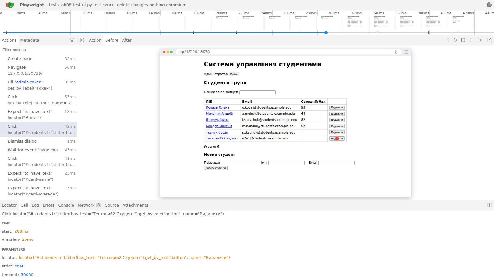
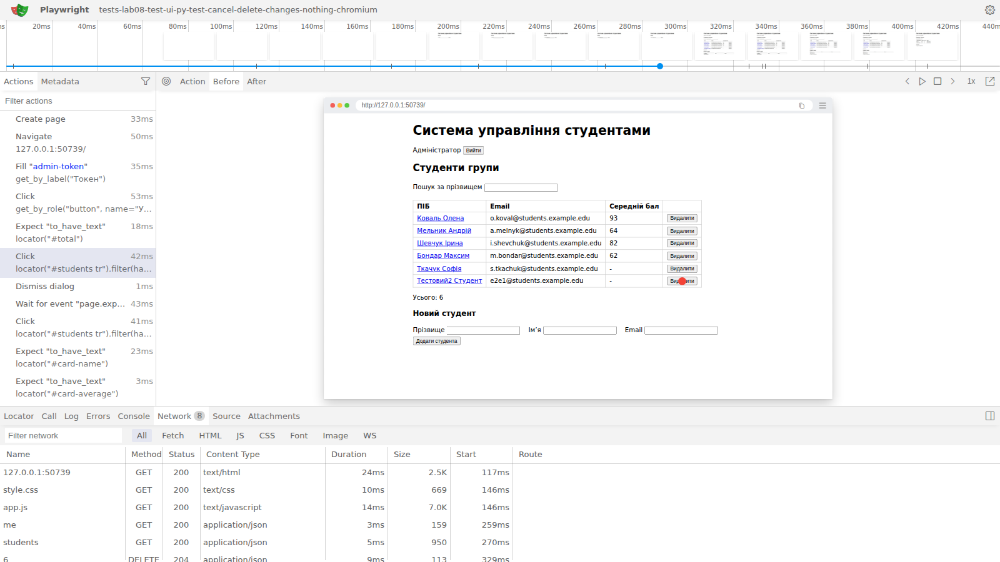
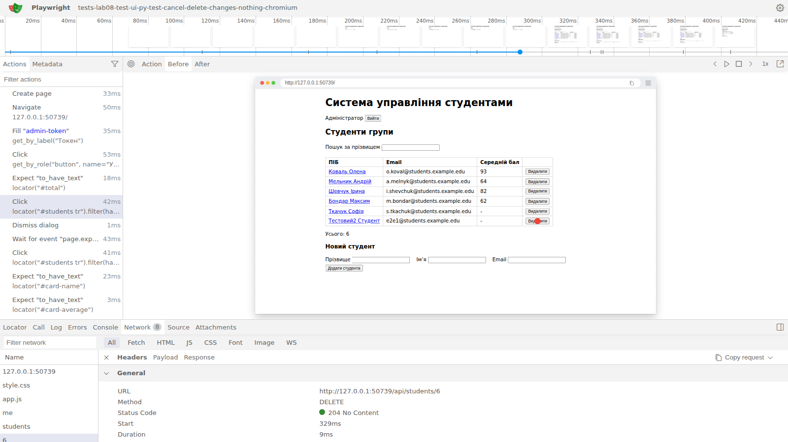

# Трасування

Тест з дефектом `test_cancel_delete_changes_nothing` (дефект [#56](https://github.com/lerabo/testing-course-bondarchuk/issues/56)) запущено без позначки xfail і з трасуванням:

```text
uv run pytest tests/lab08 -k cancel_delete --runxfail --tracing retain-on-failure --screenshot only-on-failure
uv run playwright show-trace test-results/tests-lab08-test-ui-py-test-cancel-delete-changes-nothing-chromium/trace.zip
```

Трасування записане й відкрите в переглядачі Playwright 1.64 у GitHub Actions; знімки екрана переглядача нижче.

**Дія, після якої стан розійшовся зі специфікацією.** Дія `Click locator("#students tr").filter(has_text="Тестовий2 Студент").get_by_role("button", name="Видалити")` (старт 288 мс, 42 мс), за нею `Dismiss dialog` — тест відповів «Скасувати». За Р-25 після цього нічого не має змінитися і запит на видалення не надсилається.



**DOM-знімок до дії.** Таблиця з шести студентів, «Усього: 6», червона точка — місце кліку на «Видалити» в рядку «Тестовий2 Студент». (Тут же видно й дефект #52: середній бал «93» замість «92,5».)



**Запит до API в цей момент.** На вкладці Network після кліку і відповіді «Скасувати» є запит `DELETE /api/students/6` зі статусом `204 No Content`, що стартував на 329 мс — через 41 мс після кліку і одразу після закриття діалогу. Решта запитів — завантаження сторінки, `GET /api/me`, `GET /api/students` і запити картки, яку тест відкрив наступною дією.





**Висновок.** Причина відмови — не тест і не таймінг: сторінка надсилає `DELETE` незалежно від відповіді на `confirm()`. Тест фіксує це в повідомленні `assert ['DELETE'] == []`, а трасування показує, коли і яким запитом студента видалено. Ключі `--screenshot only-on-failure` і `--video retain-on-failure` додають до теки `test-results/` також знімок екрана і відео тесту, що впав; у CI ця тека зберігається як артефакт `playwright-traces`, якщо тести впали.
