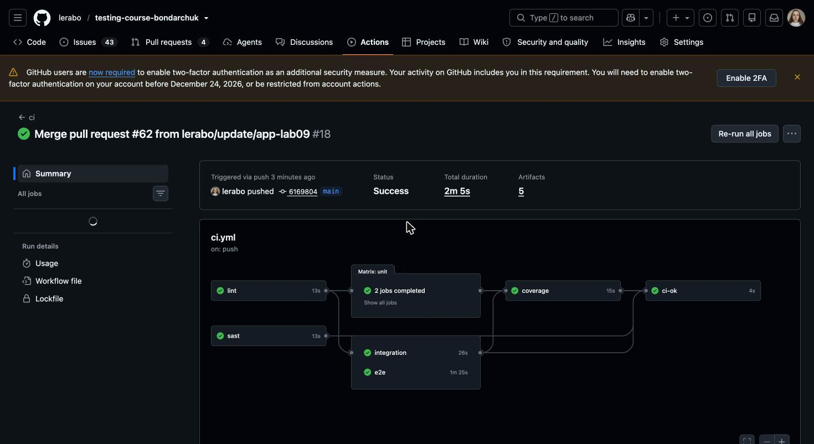
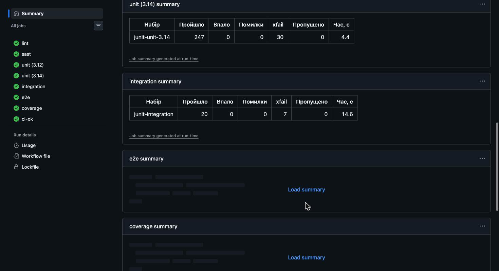
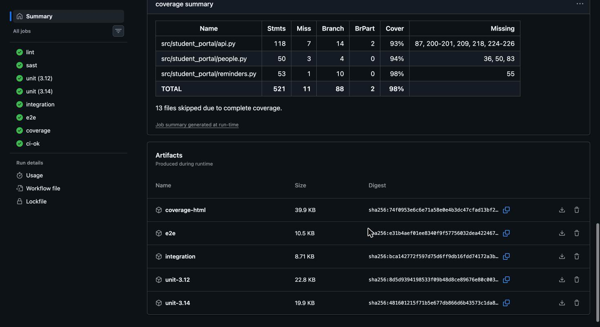
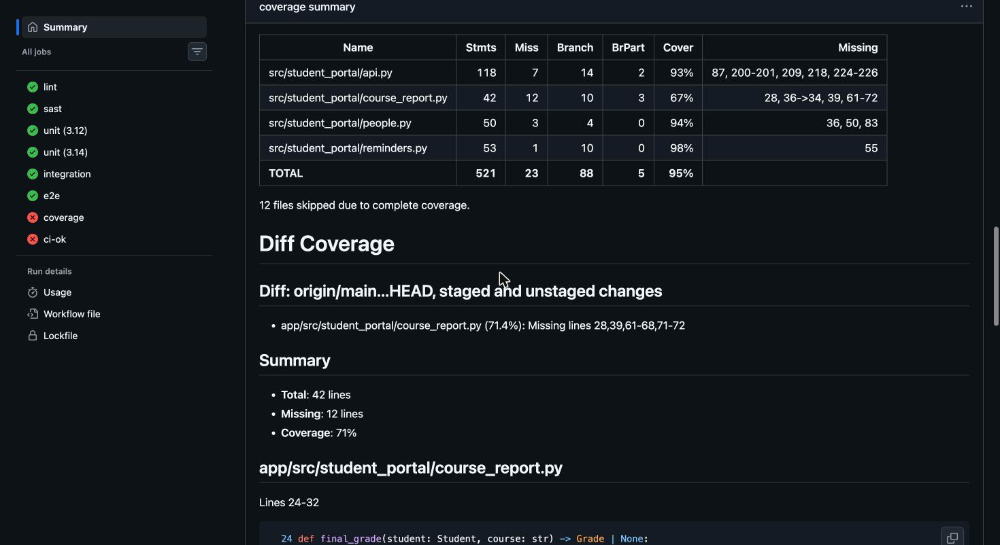

# Конвеєр CI

Конвеєр `.github/workflows/ci.yml` замінив `static-checks.yml` (запит на злиття [#58](https://github.com/lerabo/testing-course-bondarchuk/pull/58)). Тести розділено за рівнями позначками pytest, зареєстрованими в `app/pyproject.toml` і перевірюваними ключем `--strict-markers`: `integration` - тести ЛР 6 з PostgreSQL у Testcontainers (`tests/lab06/test_repository_pg.py`, `test_repository_properties.py`) і, після оновлення до app-lab09, `tests/test_repository.py`; `e2e` - тести ЛР 8 у браузері (`tests/lab08/test_ui.py`, `test_flaky.py`); без позначки - модульні, властивостей, API і контрактні тести ЛР 7, яким досить процесу pytest.

```text
lint ──┬─> unit (3.12, 3.14) ─┐
       ├─> integration ────────┼─> coverage ─┐
       └─> e2e ────────────────┘             ├─> ci-ok
sast ────────────────────────────────────────┘
```

Тривалість - з [запуску на main після злиття #62](https://github.com/lerabo/testing-course-bondarchuk/actions/runs/45069356735) (загалом 2 хв 5 с).

| Завдання | Що перевіряє | needs | Тривалість у запуску | Що потрапляє в підсумок і артефакти |
|---|---|---|---|---|
| lint | Ruff (`check`, `format --check`), `uv sync --locked`, actionlint для робочих процесів | - | 13 с | анотації Ruff біля рядків у вкладці змін |
| sast | Semgrep: `p/python` і власні правила `rules/` з ЛР 2 для `app/src` | - | 13 с | знахідки Semgrep у журналі |
| unit (3.12) | модульні, властивостей, API і контрактні тести; Python 3.12 | lint | 33 с | таблиця JUnit (xfail окремо), артефакт `unit-3.12` з JUnit XML і `.coverage.unit-3.12` |
| unit (3.14) | те саме на Python 3.14 | lint | 24 с | таблиця JUnit, артефакт `unit-3.14` |
| integration | PostgreSQL у контейнері; у CI відсутність Docker - помилка | lint | 26 с | таблиця JUnit, артефакт `integration` |
| e2e | Playwright (Chromium), трасування для тестів, що впали | lint | 1 хв 25 с | таблиця JUnit і перелік відмов, артефакт `e2e`; `playwright-traces` - лише якщо тести впали |
| coverage | `coverage combine` даних усіх рівнів; поріг 85 % (`pyproject.toml`), 100 % для `retake.py` (ЛР 5); diff-cover ≥ 90 % для запитів на злиття | unit, integration, e2e | 15 с | таблиця покриття Markdown, звіт diff-cover; артефакт `coverage-html` |
| ci-ok | `if: always()`; червоне, якщо будь-яке завдання впало або скасоване | усі | 4 с | - (єдина обов'язкова перевірка) |

**Рішення.** `lint` і `sast` - найшвидший зворотний зв'язок; `sast` не чекає на лінтер, а тестові завдання не стартують, поки код не пройде `lint`. Три рівні тестів ідуть паралельно, кожне зі своїм середовищем: Docker потрібен лише `integration`, браузер - лише `e2e`. Матриця Python 3.12 і 3.14 - тільки для `unit`, бо версія інтерпретатора впливає саме на ядро. Кожне тестове завдання пише покриття у власний файл (`COVERAGE_FILE`) і запускає pytest з `--cov-fail-under=0`: окремий рівень бачить лише частину коду і поріг 85 % не досягне. Поріг перевіряє `coverage` на об'єднаних даних; у журналі видно `Combined 4 files` - отже, дані прийшли з усіх чотирьох тестових завдань (`include-hidden-files: true` потрібен, бо файли покриття починаються з крапки). Звіти зберігаються з `if: ${{ !cancelled() }}`, тож вони є і тоді, коли тести впали. `concurrency` скасовує застарілий запуск запиту на злиття (так скасовано [запуск 6177d7a](https://github.com/lerabo/testing-course-bondarchuk/actions/runs/45068806730) після наступного push), `permissions: contents: read` - мінімальний токен, `timeout-minutes` - у кожного завдання, усі дії закріплено за SHA коміту.

**Рівні тестів у запуску на main:** unit - 247 пройдено і 30 xfail (Python 3.14), integration - 20 і 7 xfail, e2e - 18 пройдено, 9 xfail і 40 пропущених (демонстрація нестабільності ЛР 8 вмикається лише з `FLAKY_DEMO=1`). Загальне покриття об'єднаних даних - 98 %.







**Правила гілки main** (набір `main-quality-gate`): злиття лише через запит, обов'язкова перевірка - одна, `ci-ok`, увімкнено *Require branches to be up to date before merging*. Перевірки `lint`, `sast` і `tests` прибрано разом зі зміною конвеєра: якщо лишити `tests`, запити чекали б на неї безкінечно.

**Оновлення застосунку через запит на злиття** ([#62](https://github.com/lerabo/testing-course-bondarchuk/pull/62)). Перший запуск з app-lab09 мав зелені всі рівні тестів і загальне покриття 95 % (вище порогу 85 %), але `coverage` став червоним: diff-cover показав 71 % нового коду (`course_report.py`: рядки 28, 39, 61-68, 71-72 без тестів), і `ci-ok` заблокував злиття. Після тестів Р-26 у `app/tests/lab09/` (26 пройдено, 4 xfail) покриття нового коду - 100 %, загальне - 98 %, `ci-ok` зелений, запит злито. Поки його перевіряли, в `main` злили [#63](https://github.com/lerabo/testing-course-bondarchuk/pull/63), і через *up to date* гілку довелося оновити й перевірити ще раз.



| Дефект Р-26 | Тест | Issue |
|---|---|---|
| з кількох оцінок з однаковою датою зараховується перша, а не пізніше додана (`max` за датою) | `test_same_date_later_added_wins` | [#59](https://github.com/lerabo/testing-course-bondarchuk/issues/59) |
| оцінка рівно 60 не вважається складеною (`>` замість `>=`); через це не збігається і приклад тексту зі специфікації | `test_score_60_passes`, `test_text_from_specification` | [#60](https://github.com/lerabo/testing-course-bondarchuk/issues/60) |
| частка тих, хто склав, рахується від усієї групи, а не від студентів з оцінкою | `test_pass_rate_counts_only_graded_students` | [#61](https://github.com/lerabo/testing-course-bondarchuk/issues/61) |

Тести позначено `xfail(strict=True, reason="відомий дефект #N")`; решта тестів Р-26 перевіряє класи еквівалентності, межу 59/60/61, частку 2 з 3 = 66 і 1 з 3 = 33, перескладання з різною датою і в зворотному порядку додавання, порядок літер A-Fx без відсутніх, боржників за id, звіт без оцінок і текст звіту з боржниками й без них.
