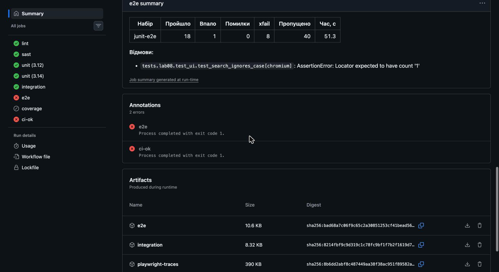

# Перевірка контрольних точок

Для кожного сценарію - тимчасова гілка від `main` (коміт 457de5a), чернетка запиту на злиття, результат; після цього запит закрито без злиття, а гілку видалено. Час - від створення запуску до завершення червоного завдання (за API GitHub Actions). У всіх сценаріях `ci-ok` червоний, і правило гілки `main` блокує злиття.

| № | Що змінено | Червоне завдання | Через скільки | Що бачить автор | Злиття заблоковано | Запит |
|---|---|---|---|---|---|---|
| 1 | Невикористаний `import os` у `grades.py` | lint | 12 с (ci-ok - 26 с) | анотація `F401 'os' imported but unused` біля рядка 3 у вкладці змін; unit, integration, e2e і coverage пропущено | так | [#64](https://github.com/lerabo/testing-course-bondarchuk/pull/64) |
| 2 | `subprocess.run(f"cp {path} {path}.bak", shell=True)` у `storage.py` | sast і lint | lint 12 с, sast 15 с | Semgrep: власне правило `rules.shell-command-from-fstring` (ЛР 2) і `python.lang.security.audit.subprocess-shell-true`; Ruff: `S602` - тестові завдання не запускались | так | [#66](https://github.com/lerabo/testing-course-bondarchuk/pull/66) |
| 3 | Очікування `ects_grade(95) == "B"` у `test_grades.py` | unit (3.12) і unit (3.14) | 40 і 43 с (ci-ok - 1 хв 48 с) | у підсумку запуску - рядок «Впало: 1» і відмова `AssertionError: assert 'A' == 'B'`; integration і e2e зелені | так | [#67](https://github.com/lerabo/testing-course-bondarchuk/pull/67) |
| 4 | Прибрано `@known_defect("#53")` з `test_search_ignores_case` (ЛР 8) | e2e | 2 хв 0 с | у підсумку - «Впало: 1» і `Locator expected to have count '1'`; артефакт `playwright-traces` (390 КБ) з трасуванням тесту | так | [#68](https://github.com/lerabo/testing-course-bondarchuk/pull/68) |
| 5 | Залежність `rich>=14` в `app/pyproject.toml` без `uv lock` | lint | 9 с (ci-ok - 36 с) | `error: The lockfile at uv.lock needs to be updated, but --locked was provided.`; тестові завдання не запускались | так | [#69](https://github.com/lerabo/testing-course-bondarchuk/pull/69) |
| 6 | `pytestmark = pytest.mark.intgration` у `test_repository_pg.py` | unit (обидві версії), integration, e2e | 31-41 с | `'intgration' not found in markers configuration option` - модуль не збирається в жодному тестовому завданні, навіть там, де його тести не вибрано | так | [#70](https://github.com/lerabo/testing-course-bondarchuk/pull/70) |
| 7 | Нова функція `Group.best_student` без тесту | coverage | 2 хв 1 с | загальний поріг пройдено (96 %), але diff-cover: `group.py (20.0%): Missing lines 61-64`, «Coverage is below 90%» | так | [#71](https://github.com/lerabo/testing-course-bondarchuk/pull/71) |

**Висновки.** Кожна контрольна точка спрацювала саме там, де очікувалося, і всі сім змін заблоковано однією перевіркою `ci-ok`. Найшвидший сигнал - `lint` (9-12 с), найповільніший - `e2e` і `coverage` (близько 2 хв), бо `coverage` чекає на всі рівні тестів. У сценарії 2 небезпечний виклик знайшли двічі: Ruff з набором правил `S` (bandit) і Semgrep; це дублювання корисне, бо Semgrep має ще й власне правило проєкту. Трасування сценарію 4 збережено як артефакт; завантажити його звідси не вдалося, його відкривають локально командою `uv run playwright show-trace trace.zip` після завантаження зі сторінки запуску.

**Що конвеєр пропустить.** Жоден із семи сценаріїв не пройшов, але є зміна, яку ці контрольні точки не помітять: видалення тесту, що покриває старий код. diff-cover перевіряє лише змінені рядки коду застосунку, а загальне покриття (98 %) після видалення одного тесту лишиться вищим за поріг 85 %. Закрити цю дірку можна правилом «покриття на main не зменшується»: зберігати загальне покриття як базове і порівнювати з ним у запиті на злиття (наприклад, `--fail-under` з останнього зеленого запуску main або сервіс на кшталт Codecov з `target: auto`).
